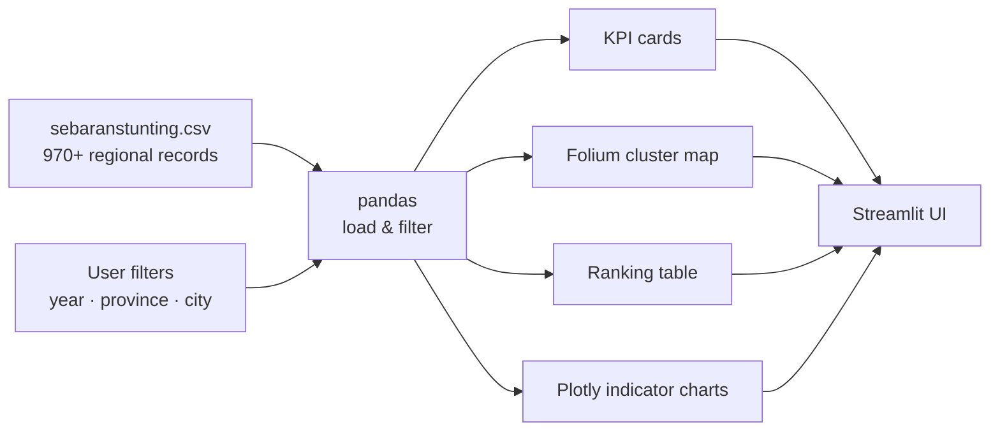

<h1 align="center">📊 Stunting Prevalence Dashboard</h1>

<p align="center">
  Interactive analytics dashboard that maps stunting prevalence across Indonesian regencies and cities,<br/>
  helping identify which regions need intervention and which health indicators lag behind.
</p>

<p align="center">
  
  
  
  
  
</p>

<p align="center">
  <!-- Replace with your deployed URL after publishing on Streamlit Community Cloud -->
  <a href="https://YOUR-APP.streamlit.app"><b>Live demo</b></a> ·
  <a href="#-getting-started"><b>Run locally</b></a>
</p>

---

## Overview

Stunting is one of Indonesia's most pressing public-health problems. Government data on it is spread across wide tables with dozens of indicators per region, which makes it hard for decision makers to see *where* the problem is concentrated and *why*.

This dashboard turns that data into a single interactive view. It combines prevalence figures with the **IKPS** (*Indeks Khusus Penanganan Stunting*, the Special Index for Stunting Handling) and its health, nutrition, housing, education, and social-protection dimensions, then groups regions into clusters so priorities are visible at a glance.

**Dataset:** 970+ regency/city records for 2020–2022, with 25 attributes per record (location, toddler population, stunting cases, prevalence, 10 service indicators, 5 IKPS dimensions, and a cluster label).

## Features

- **Filters** by year, province, and regency/city, with cascading options (cities follow the selected province).
- **KPI cards** for total toddlers, total stunting cases, average prevalence, and average IKPS.
- **Cluster map** built with Folium and marker clustering. Each region is colored by its cluster (good, moderate, or high prevalence) and shows estimated handled vs. unhandled cases in its popup.
- **Regional ranking table** to compare regions side by side.
- **Trend chart** comparing average prevalence against IKPS over the years.
- **Indicator breakdown** (Plotly bar chart) showing which services, such as immunization, clean water, sanitation, exclusive breastfeeding, or early-childhood education, are weakest in the selected area.
- **Automatic summary** of the analysis for the current selection.

## Screenshots

> Add screenshots to `docs/` and they will render here.

| Overview & KPIs | Cluster map | Indicator analysis |
| :-: | :-: | :-: |
|  |  |  |

## Tech stack

| Layer | Tools |
| :-- | :-- |
| App framework | Streamlit, streamlit-extras |
| Data processing | pandas |
| Geospatial | Folium, streamlit-folium, MarkerCluster |
| Charts | Plotly Express, Streamlit native charts |
| Dev environment | Dev Container / GitHub Codespaces (Python 3.11) |

## Architecture



## Project structure

```
stunting-prevalence-dashboard/
├── .devcontainer/
│   └── devcontainer.json   # one-click Codespaces setup
├── data/
│   └── sebaranstunting.csv # regional stunting dataset, 2020–2022
├── docs/                   # screenshots used in this README
├── dashboard.py            # Streamlit application
├── requirements.txt
└── README.md
```

## 🚀 Getting started

**Prerequisites:** Python 3.10 or newer.

```bash
# 1. Clone the repository
git clone https://github.com/halimochy/stunting-prevalence-dashboard.git
cd stunting-prevalence-dashboard

# 2. Create and activate a virtual environment
python -m venv .venv
source .venv/bin/activate        # Windows: .venv\Scripts\activate

# 3. Install dependencies
pip install -r requirements.txt

# 4. Run the dashboard
streamlit run dashboard.py
```

The app opens at `http://localhost:8501`.

**Or open it in GitHub Codespaces:** click **Code → Codespaces → Create codespace**. The dev container installs everything and starts the app automatically.

## Future improvements

- Add 2023–2024 data and an automated ETL step that refreshes the CSV from the official source.
- Replace markers with a province/regency choropleth layer.
- Move clustering into the app (for example k-means with scikit-learn) so clusters update with new data.
- Add English/Indonesian language toggle.
- Add unit tests for the filtering and aggregation logic.

## Author

**Nurhalimah** · [GitHub](https://github.com/halimochy) · [LinkedIn](https://www.linkedin.com/in/halimahnvr)
